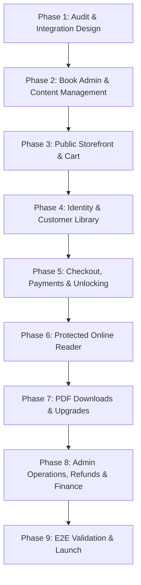
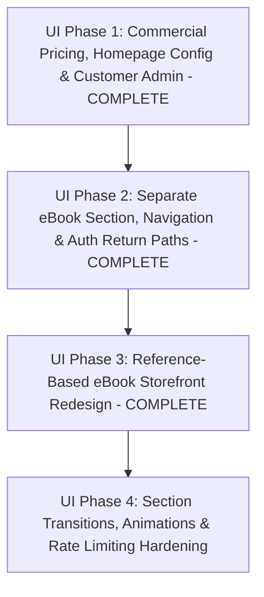

# KnowledgePaat — Phase 1: 9-Phase Implementation Roadmap
**Target Application:** KnowledgePaat ([https://www.knowledgepaat.com](https://www.knowledgepaat.com))  
**Architectural Blueprint:** End-to-End eBook Commerce & Protected Reader Subsystem  
**Status:** Approved Roadmap  
**Date:** October 2026  

---

## Roadmap Overview

---

## Phase 1: Repository Audit & Integration Design (CURRENT PHASE)
- **Scope & Dependencies**: Read all repository configurations, inspect existing payment, storage, auth, and database modules. Create foundational architectural blueprints.
- **Likely Files / Modules Affected**:
  - `docs/ebooks/phase-1-audit.md`
  - `docs/ebooks/integration-design.md`
  - `docs/ebooks/implementation-phases.md`
  - `docs/ebooks/phase-2-checklist.md`
- **Database Changes**: None. Zero schema changes during Phase 1.
- **Customer & Admin Behaviors**: No production data or live traffic impacted.
- **Loading, Empty, Error & Recovery States**: N/A (Documentation phase).
- **Appropriate Tests**:
  - `npx tsc --noEmit` (TypeScript pass)
  - `npm run build` (Turbopack production build pass)
  - `npx -y tsx scripts/test_razorpay_integration.ts` (Payment test suite pass)
  - `npx -y tsx scripts/test_deep_security_audit.ts` (Security audit pass)
- **Manual Acceptance Checks**:
  - Verify all 4 documents exist and link to verified file paths.
- **Definition of Done**: Technical feasibility verified, architectural contracts specified, and stakeholder roadmap approved.

---

## Phase 2: Book Administration & Content Management
- **Scope & Dependencies**: Establish database schema (`ebooks`, `ebook_editions`, `ebook_chapters`), configure Supabase storage buckets (`ebook-covers`, `ebook-pdfs`), and build admin interfaces for book creation, chapter authoring, sample chapter toggling, and PDF uploads.
- **Likely Files / Modules Affected**:
  - `supabase/migrations/supabase_ebook_schema_setup.sql`
  - `frontend/layouts/AdminLayout.tsx` (Add navigation items)
  - `frontend/app/admin/e-books/page.tsx` (Book list)
  - `frontend/app/admin/e-books/new/page.tsx` (Book creation)
  - `frontend/app/admin/e-books/[bookId]/edit/page.tsx` (Book editor & edition management)
  - `frontend/app/admin/e-books/[bookId]/editions/[editionId]/chapters/page.tsx` (Chapter authoring)
  - `frontend/app/api/admin/ebooks/route.ts` & sub-routes
  - `frontend/app/api/admin/ebooks/[bookId]/upload/route.ts`
- **Database Changes**:
  - Create tables: `ebooks`, `ebook_editions`, `ebook_chapters`, `ebook_audit_logs`.
  - Create Supabase storage buckets: `ebook-covers` (public) and `ebook-pdfs` (private).
- **Customer & Admin Behaviors**:
  - Admin can log into `/admin/login`, navigate to "eBooks", create a book, upload a cover image, define editions, author chapters in a rich text/Markdown editor, mark chapters as "Free Sample", and upload the publication PDF.
  - Public customers do not see unfinished drafts.
- **Loading, Empty, Error & Recovery States**:
  - Loading: Skeleton table loaders on book lists.
  - Empty: Clean empty state using `EmptyState.tsx` prompting admin to create their first eBook.
  - Error: Upload validation errors (reject non-PDF files or files > 100MB).
  - Recovery: Form state preservation during network interruptions.
- **Appropriate Tests**:
  - `frontend/scripts/test_ebook_admin_management.ts`: Verify CRUD, file validations, chapter ordering constraints, and admin role enforcement.
- **Manual Acceptance Checks**:
  - Create an eBook titled *"Mastering Full-Stack Engineering"*, author 3 chapters, mark Chapter 1 as free sample, upload a test PDF, and verify private storage permissions.
- **Definition of Done**: Admin can create, edit, reorder, preview, and archive books, editions, and chapters with verified database persistence.

---

## Phase 3: Public Storefront & Cart
- **Scope & Dependencies**: Build the public-facing bookstore catalog (`/e-books`), individual book detail pages (`/e-books/[bookId]`), free sample reading drawer/modal, and an unauthenticated guest shopping cart (`/cart`).
- **Likely Files / Modules Affected**:
  - `frontend/layouts/PublicLayout.tsx` (Add "eBooks" to navigation and cart count badge)
  - `frontend/app/e-books/page.tsx` (Catalog grid: 2 cards per row on desktop)
  - `frontend/app/e-books/[bookId]/page.tsx` (Detail view, TOC, pricing comparison)
  - `frontend/app/cart/page.tsx` (Cart page)
  - `frontend/hooks/useEBookCart.ts` (Client-side localStorage cart hook)
  - `frontend/components/SampleReaderDrawer.tsx` (Free chapter preview drawer)
  - `frontend/app/api/ebooks/route.ts`
  - `frontend/app/api/ebooks/[bookId]/route.ts`
  - `frontend/app/api/ebooks/[bookId]/sample/[chapterId]/route.ts`
- **Database Changes**: None. Uses existing tables populated in Phase 2.
- **Customer & Admin Behaviors**:
  - Public visitors (no login required) can browse the catalog, read descriptions, view tables of contents, open and read free sample chapters, select either "Read Online (₹49)" or "Read + Download (₹99)", and add items to cart.
  - Enforces 1 item per book (no quantity selector). Allows different books to have different plans in the same cart.
- **Loading, Empty, Error & Recovery States**:
  - Loading: Shimmer book card skeletons.
  - Empty: Empty cart state with "Explore Books" button.
  - Error: 404 page if invalid book ID requested.
  - Recovery: Cart persists across browser refreshes via `localStorage`.
- **Appropriate Tests**:
  - `frontend/scripts/test_ebook_public_storefront.ts`: Test public API accessibility, sample chapter retrieval, and cart item deduplication logic.
- **Manual Acceptance Checks**:
  - Open an incognito browser window, navigate to `/e-books`, read sample chapter, add book with ₹49 plan, change plan in `/cart` to ₹99, verify price updates to ₹99 without login.
- **Definition of Done**: Public storefront, sample preview, and guest cart operate smoothly with zero authentication barriers.

---

## Phase 4: Identity & Customer Library Integration
- **Scope & Dependencies**: Integrate customer identity verification with cart state, adapt middleware for protected customer routes, and build the customer digital library (`/my-books`).
- **Likely Files / Modules Affected**:
  - `frontend/utils/supabase/middleware.ts` (Update route gates for `/checkout`, `/my-books`, `/read`)
  - `frontend/app/my-books/page.tsx` (Customer library page)
  - `frontend/layouts/StudentLayout.tsx` (Add "My Books" link to sidebar)
  - `frontend/app/api/ebooks/library/route.ts`
- **Database Changes**:
  - Create table: `ebook_reading_progress`.
- **Customer & Admin Behaviors**:
  - Visitors clicking "Proceed to Checkout" from `/cart` are directed to sign in or register if unauthenticated, preserving cart contents.
  - Authenticated customers can navigate to `/my-books` to view their unlocked books, access plans (`Read Online` vs `Read + Download`), and reading completion percentages.
- **Loading, Empty, Error & Recovery States**:
  - Loading: Card skeleton grid on `/my-books`.
  - Empty: Prompt to explore bookstore when no books are owned.
  - Error: Unauthenticated access to `/my-books` redirects to `/login?redirectTo=/my-books`.
- **Appropriate Tests**:
  - `frontend/scripts/test_ebook_identity_and_library.ts`: Test auth gating on customer routes and profile data isolation.
- **Manual Acceptance Checks**:
  - Attempt accessing `/my-books` while logged out (verify redirect to login); log in as a student (verify library renders).
- **Definition of Done**: Verified customer authentication guards library routes while seamlessly retaining cart state.

---

## Phase 5: Checkout, Payments, Purchases & Unlocking
- **Scope & Dependencies**: Implement authoritative checkout order creation, Razorpay payment processing, HMAC signature verification, automated existing ownership detection, and entitlement unlocking.
- **Likely Files / Modules Affected**:
  - `frontend/app/checkout/page.tsx` (Checkout interface)
  - `frontend/app/api/ebooks/orders/create/route.ts`
  - `frontend/app/api/ebooks/orders/verify/route.ts`
  - `frontend/app/api/payments/razorpay/webhook/route.ts` (Add eBook event handling)
  - `frontend/lib/razorpay.ts`
- **Database Changes**:
  - Create tables: `ebook_orders`, `ebook_order_items`, `ebook_entitlements`.
- **Customer & Admin Behaviors**:
  - Customer reviews order on `/checkout`. The server calculates prices (₹49 / ₹99) and checks existing entitlements.
  - Razorpay checkout modal opens. Upon payment completion, signature is verified server-side, `ebook_entitlements` are created, the cart is cleared, and the user is redirected to `/my-books` with a success toast.
- **Loading, Empty, Error & Recovery States**:
  - Loading: Payment processing spinner overlay.
  - Error: Friendly error banner if payment signature fails or card is declined.
  - Recovery: If customer closes browser during payment, Razorpay webhook completes order and provisions entitlement asynchronously.
- **Appropriate Tests**:
  - `frontend/scripts/test_ebook_payment_and_unlocking.ts`: Test server-side price enforcement, signature forgery rejection, webhook idempotency, and entitlement provisioning.
- **Manual Acceptance Checks**:
  - Complete a test-mode checkout for ₹49, confirm order status is `paid` in database, verify instant unlocking in `/my-books`.
- **Definition of Done**: End-to-end checkout, payment verification, and entitlement unlocking function reliably with complete tampering immunity.

---

## Phase 6: Protected Online Reader
- **Scope & Dependencies**: Develop the distraction-free online reader interface (`/read/[bookId]/[chapterId]`) with server-side entitlement checks, chapter content streaming, reading typography settings, and reading progress autosaving.
- **Likely Files / Modules Affected**:
  - `frontend/app/read/[bookId]/[chapterId]/page.tsx` (Reader UI)
  - `frontend/app/api/ebooks/read/[bookId]/[chapterId]/route.ts`
  - `frontend/app/api/ebooks/read/progress/route.ts`
  - `frontend/components/ReaderSettingsModal.tsx` (Font size, light/sepia/dark themes)
- **Database Changes**: None.
- **Customer & Admin Behaviors**:
  - Customer with active `read_online` or `read_download` entitlement reads chapters sequentially.
  - Sidebar displays table of contents with completion status.
  - Reader autosaves scroll position and active chapter.
  - Unentitled users attempting to hit the chapter API receive HTTP 403 Forbidden.
- **Loading, Empty, Error & Recovery States**:
  - Loading: Clean typography skeleton while chapter fetches.
  - Error: 403 screen with "Purchase Access" button if unentitled.
  - Recovery: Resumes reading at last saved chapter and scroll offset upon return.
- **Appropriate Tests**:
  - `frontend/scripts/test_ebook_reader_protection.ts`: Verify chapter gating, absence of PDF disclosure, and reading progress updates.
- **Manual Acceptance Checks**:
  - Log in as online-only buyer, read Chapter 1 and Chapter 2, adjust font size, refresh browser (verify position is restored), inspect network tab (verify no PDF file was downloaded).
- **Definition of Done**: Online reader delivers a responsive, distraction-free reading experience while strictly protecting paid content.

---

## Phase 7: PDF Downloads & Upgrades
- **Scope & Dependencies**: Implement secure PDF download delivery for eligible buyers (`read_download`), and the ₹50 upgrade path for existing online-only buyers (`read_online` -> `read_download`).
- **Likely Files / Modules Affected**:
  - `frontend/app/api/ebooks/download/route.ts`
  - `frontend/app/api/ebooks/orders/upgrade/route.ts`
  - `frontend/app/my-books/page.tsx` (Add "Download PDF" and "Upgrade to PDF (+₹50)" buttons)
  - `frontend/app/e-books/[bookId]/page.tsx` (Detect existing ownership and adjust CTA)
- **Database Changes**: None.
- **Customer & Admin Behaviors**:
  - `read_download` buyers see an active "Download PDF" button that generates a temporary 60-second signed URL.
  - `read_online` buyers see an "Upgrade to PDF (+₹50)" banner. Clicking it opens checkout charging strictly ₹50, and upon verification upgrades entitlement to `read_download`.
  - Online-only buyers calling `/api/ebooks/download` receive HTTP 403 Forbidden.
- **Loading, Empty, Error & Recovery States**:
  - Loading: "Generating secure link..." spinner on download button.
  - Error: Warning dialog if storage file is missing or plan is ineligible.
- **Appropriate Tests**:
  - `frontend/scripts/test_ebook_pdf_and_upgrade_flow.ts`: Verify signed URL generation, ineligibility blocking, and ₹50 upgrade price calculation.
- **Manual Acceptance Checks**:
  - Buy online plan for ₹49; verify download is blocked; click upgrade, pay ₹50 test order; verify download is now enabled and signed PDF downloads successfully.
- **Definition of Done**: PDF download delivery is restricted to eligible tiers, and upgrade checkout reliably elevates access.

---

## Phase 8: Admin Operations, Refunds, Finance & Reporting
- **Scope & Dependencies**: Build the administrative order management dashboard (`/admin/e-book-orders`), customer access adjustment suite, settlement reconciliation tracking, and automated refund processing.
- **Likely Files / Modules Affected**:
  - `frontend/app/admin/e-book-orders/page.tsx` (Order list, filters, export)
  - `frontend/app/admin/e-book-orders/[orderId]/page.tsx` (Order details, manual adjustment, refund modal)
  - `frontend/app/api/admin/ebooks/orders/route.ts`
  - `frontend/app/api/admin/ebooks/orders/[orderId]/refund/route.ts`
  - `frontend/app/api/admin/ebooks/entitlements/adjust/route.ts`
- **Database Changes**: None.
- **Customer & Admin Behaviors**:
  - Admins can search orders by customer email or transaction ID, inspect line items (original vs upgrade), and export CSV reports.
  - Admins can issue full refunds: triggers Razorpay Refund API, marks order `refunded`, and revokes access.
  - Admins can manually grant complimentary access, requiring a logged reason and administrator ID (tracked in `ebook_audit_logs`). Complimentary grants are never logged as ₹0 paid transactions.
- **Loading, Empty, Error & Recovery States**:
  - Loading: Table skeletons during data fetching.
  - Error: Modal error alert if refund is rejected by bank.
- **Appropriate Tests**:
  - `frontend/scripts/test_ebook_admin_finance_and_refunds.ts`: Test refund revocation, complimentary access audit trails, and financial record immutability.
- **Manual Acceptance Checks**:
  - Grant complimentary access to a test user, confirm audit log entry; process a test refund on an order, verify customer library immediately revokes access.
- **Definition of Done**: Complete administrative governance, truthful financial accounting, and provider-confirmed refund processing are operational.

---

## Phase 9: End-to-End Validation, Security Hardening & Launch
- **Scope & Dependencies**: Conduct full regression testing, security vulnerability scans, performance benchmarking under simulated load, SEO structured data verification, and production readiness certification.
- **Likely Files / Modules Affected**:
  - `frontend/scripts/test_ebook_full_e2e_suite.ts`
  - `frontend/app/sitemap.ts` (Add `/e-books` and published book slugs)
  - `docs/ebooks/launch-readiness-report.md`
- **Database Changes**: Apply production indexes for fast querying.
- **Customer & Admin Behaviors**: Complete end-to-end user journeys tested on staging and verified for production rollout.
- **Loading, Empty, Error & Recovery States**: All edge cases, 404s, payment drops, and network failures audited.
- **Appropriate Tests**:
  - Full automated regression suite (all scripts in `frontend/scripts/`).
  - Production build verification (`npm run build`).
  - SEO JSON-LD schema validation.
- **Manual Acceptance Checks**:
  - Complete full customer journey: browse -> read sample -> add to cart -> register -> pay ₹49 -> read online -> upgrade for ₹50 -> download PDF -> admin audit -> refund.
- **Definition of Done**: 100% test pass rate, zero regressions, and formal production sign-off.

---

# UI Enhancement 4-Phase Roadmap

## UI Enhancement Phase 1: Pricing Engine, Homepage & Customer Management (COMPLETED)
- **Status:** **COMPLETE & VERIFIED (36/36 Automated Checks Passing)**
- **Scope**:
  - Single authoritative commercial pricing in `public.ebook_pricing` with unique constraint per edition.
  - Commercial price modifications on published books decoupled from immutable chapter text and PDF storage references.
  - Compatibility mirrors in `ebook_editions` updated synchronously; pricing versions and audit trails recorded atomically.
  - Integer paise calculations, deterministic half-up rounding, and rejection of ₹0 commercial offers.
  - Optimistic concurrency control via `pricing_version` with HTTP 409 Conflict rejection for stale administrator edits.
  - Modern eBook Storefront Content Editor (`/admin/e-books/homepage`) with isolated draft and atomic publishing.
  - eBook Customer Management (`/admin/e-book-customers`) with bounded server-side pagination, search, and audited access actions.
  - Dynamic pricing integration across storefront catalogue, book details, cart validation, checkout, and upgrade quotes.
- **Key Artifacts & Docs**:
  - `docs/ebooks/ui-phase-1-implementation.md`
  - `docs/ebooks/ui-phase-1-checklist.md`
  - `docs/ebooks/ui-phase-1-manual-tests.md`
  - `frontend/scripts/test_ui_phase1_suite.ts`

## UI Enhancement Phase 2: Separate eBook Section, Dedicated Navigation & Auth Return Paths (COMPLETED)
- **Status:** **COMPLETE & VERIFIED (32/32 Automated Checks Passing)**
- **Scope**:
  - Added "E-Books" navigation button directly beside the hamburger menu in `PublicLayout.tsx`.
  - Removed standalone eBook shopping cart icon control from main platform header (retained inside bookstore only).
  - Created dedicated `EBookLayout.tsx` with official KnowledgePaat logo linking to `/`, "eBooks" badge, Store Home (`/e-books`), Browse Books (`/e-books#catalogue`), Categories dropdown with category filtering, My Books (`/my-books`), fast search toggle, and cart badge.
  - Accessible mobile drawer with `role="dialog"`, `aria-modal="true"`, `Escape` listener, focus restoration, accessible close button, and zero horizontal overflow.
  - Dedicated 4-column bookstore footer with brand mission, bookstore links, career platform links, account controls, dynamic social links, and "Back to KnowledgePaat Platform Home" (`/`).
  - Correct page wrappers applied across `/e-books`, `/e-books/[bookId]`, `/cart`, `/checkout`, `/checkout/success`, and `/my-books`. Preserved distraction-free `/read/...` and administrative `AdminLayout`. Zero simultaneous header rendering.
  - Preserved public anonymous browsing for catalogue, search, filters, details, samples, and guest cart.
  - Authenticated student access verified without unwanted redirects to `/student/dashboard`.
  - Secure authentication return paths via `sanitizeInternalRedirectUrl`, rejecting open-redirect and protocol attack vectors.
  - Cart state continuity across route changes via `EBookCartProvider` at root layout under canonical key `knowledgepaat_ebook_cart_v1`.
- **Key Artifacts & Docs**:
  - `docs/ebooks/ui-phase-2-implementation.md`
  - `docs/ebooks/ui-phase-2-checklist.md`
  - `docs/ebooks/ui-phase-2-manual-tests.md`
  - `frontend/scripts/test_ui_phase2_suite.ts`
  - `frontend/scripts/capture_phase2_screenshots.ts`
  - Visual Screenshots: `screenshots/ui_phase2_*.png`

## UI Enhancement Phase 3: Reference-Based eBook Storefront Redesign (COMPLETED)
- **Status:** **COMPLETE & VERIFIED (15/15 Automated Checks Passing, 9 Visual Screenshots Captured, Clean Build)**
- **Scope**:
  - Established visual design tokens (`globals.css`): `#130B24` / `#1B0E36` deep purple, `#FAF9FD` lavender background, `#FBBF24` / `#F59E0B` gold accents, `#EBE5F5` card borders, and Google Font `Playfair Display` serif typography.
  - Preserved official brand asset (`/brand/knowledgepaat_logo.png`) inside high-contrast crisp white container.
  - Implemented Reference Two-Column Hero:
    - Left: Gold eyebrow pill, large Playfair Display serif heading with gold gradient highlight, description, 3 benefit pills, gold CTA to `#catalogue`.
    - Right: Three-book 3D perspective stage with tilted left/right books, central featured book, and violet elliptical pedestal.
  - Curated Selection: 4 horizontal cards across desktop, 1 on mobile, featuring 3D thumbnail, serif title, author, genuine rating (never fabricated), authoritative selling price with discount strikethrough, and state-aware "Add" / "In Cart" / "Read" actions. Graceful padding from catalogue if < 4 books configured.
  - Spotlight Publication Section: 3-column layout with large 3D book cover, center spotlight details with green platform benefits checklist, and right two access plan cards ("Read Online" vs "Read + Download") with server pricing and recommended gold badge. Direct `addToCart(bookId, plan)` integration.
  - Full Catalogue at `#catalogue`: 2 cards per row on desktop, 1 on mobile, sticky search toolbar, category filter pills, pagination controls, and active category state.
  - Complete elimination of hardcoded `₹49` / `₹99` fallback strings across storefront, drawers, cart, checkout licensing, and book details.
  - Dedicated deep purple footer with contrast logo container, 4-column directory, SVG social icons, and platform return link.
  - Aesthetic harmony applied to downstream pages (`/e-books/[bookId]`, `/cart`, `/checkout`, `/my-books`).
- **Key Artifacts & Docs**:
  - `docs/ebooks/ui-phase-3-implementation.md`
  - `docs/ebooks/ui-phase-3-checklist.md`
  - `docs/ebooks/ui-phase-3-manual-tests.md`
  - `frontend/scripts/test_ui_phase3_suite.ts`
  - `frontend/scripts/capture_phase3_screenshots.ts`
  - Visual Screenshots: `screenshots/01_desktop_storefront_hero_featured.png` through `09_my_books_phase3.png`

## UI Enhancement Phase 4: Section Transitions, Distributed Rate Limiting & Scalable Pagination (REMEDIATION COMPLETE)
- **Status:** **REMEDIATION COMPLETE & VERIFIED (19/20 Remediation Checks Passed, 1 UNVERIFIED Edge Proxy Requirement, 21/21 UI Phase 4 Regression Checks Passed, Clean Build)**
- **Scope & Deliverables**:
  - **Section-Switching Animation**: 350ms directional slide animations with `overflow-x: clip` eliminating layout shift and horizontal scrollbars. Main→EBooks slides left/enters right; EBooks→Main slides right/enters left.
  - **Accessibility**: `@media (prefers-reduced-motion: reduce)` immediate 0ms transition bypass with `opacity: 1 !important`.
  - **Navigation Integrity**: Client router navigation fires immediately without artificial delay; native modifier keys (`metaKey`, `ctrlKey`, `shiftKey`, `altKey`) and middle-click new tab opening preserved.
  - **Shared Rate-Limit Atomicity & Dedicated Storage**: In-process `withKeyLock` mutex completely eliminated. Multi-instance shared state persisted in dedicated table `ebook_webhook_events` (`gateway='rate_limit'`). Unique constraint on `event_id` (`rl:${key}:${windowBucket}:${slot}`) guarantees multi-instance atomicity. `public.ebook_audit_logs` contains 0 ephemeral rate-limit rows, keeping business audit history intact. Bounded retention automatically purges expired rate-limit slots without deleting business audit events.
  - **Real Cross-Process Concurrency**: Concurrently executed across 6 distinct OS child processes (`rate_limit_worker.ts`). Exactly 4 allowed (limit 4) and 2 blocked with HTTP 429 and accurate `Retry-After`. Quota persists across process restarts (restarted process immediately blocked). Customer B maintains independent quota. Sensitive mutations rejected by rate limit leave business state invariant (0 entitlements modified).
  - **Forwarded-IP Trust & Anti-Spoofing**: Forwarded client-IP headers (`cf-connecting-ip`, `x-real-ip`, `x-forwarded-for`) are accepted ONLY when `TRUST_PROXY=true`. Authenticated customer account quotas bind strictly to verified customer identity (`auth.user.id`), immune to header spoofing. Edge proxy trust labeled **UNVERIFIED in local runner** with documented reverse-proxy requirements.
  - **Endpoint Policy Coverage & Truthful 503 Outage**: All 18 policies verified and actively invoked across all corresponding API routes. Quota exhaustion returns HTTP 429 (`RATE_LIMIT_EXCEEDED`). Backend outage returns truthful HTTP 503 (`LIMITER_UNAVAILABLE`), safely protecting sensitive operations while enabling payment provider webhook retries. Public search degrades safely to in-memory sliding store during DB outage.
  - **Complete Filtered CSV Export (>5,000 Records)**: Replaced single capped query with bounded batched retrieval (`BATCH_SIZE=1000`, `MAX_CSV_EXPORT=10000`) overcoming PostgREST 1,000-row limit. Verified with 5,100 disposable order fixtures: exported all 5,100 records (>1,000 and >5,000 verified), filtered subset (2,600 paid), 0 omissions, 0 duplicates, formula injection protection (`sanitizeCsvField`). Disposable fixtures cleanly purged.
  - **Server-Side Pagination**: Bounded limits (1-50), stable deterministic sorting (`created_at DESC, id ASC`), PGRST103 safe out-of-range empty page handling.
  - **Visual & Content Accuracy**: Exact paise formatting preserved across all views; unsupported fixed claims removed.
- **Key Artifacts & Docs**:
  - `docs/ebooks/ui-phase-4-implementation.md`
  - `docs/ebooks/ui-phase-4-checklist.md`
  - `docs/ebooks/ui-phase-4-manual-tests.md`
  - `docs/ebooks/ui-enhancements-final-report.md`
  - `frontend/scripts/test_phase4_remediation_suite.ts`
  - `frontend/scripts/test_ui_phase4_suite.ts`
  - `frontend/scripts/rate_limit_worker.ts`
  - `frontend/scripts/capture_phase4_journeys.ts`
  - Visual Evidence: `screenshots/phase4_journey_a_bookstore_entry.png` through `phase4_journey_j_admin_live_presentation.png`

