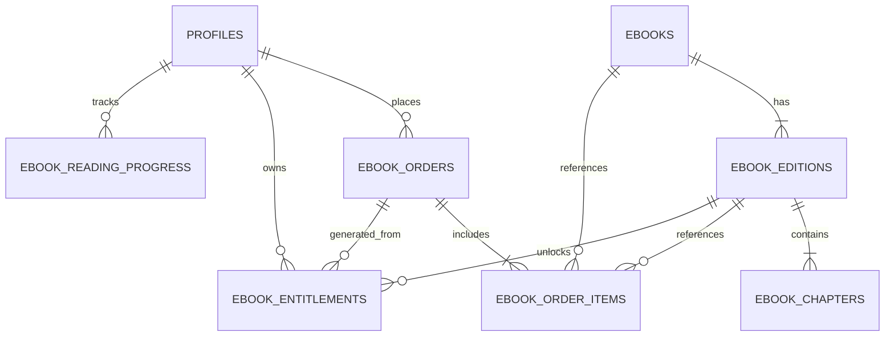
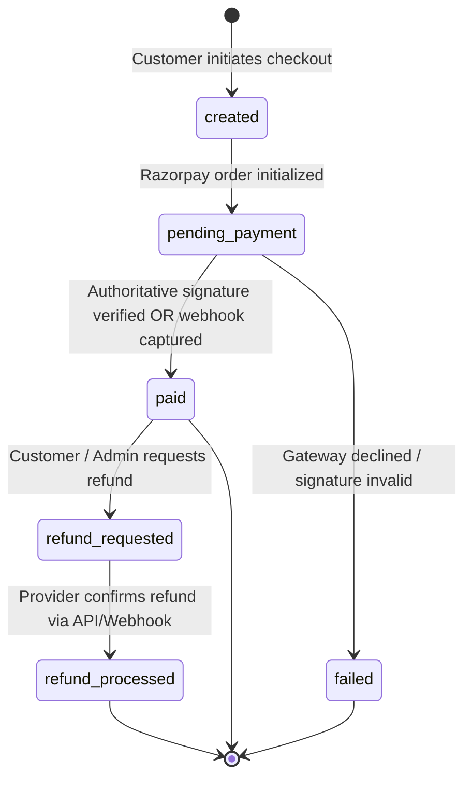
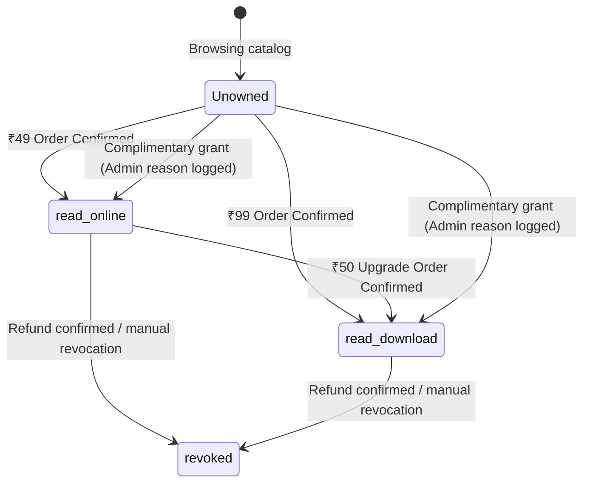
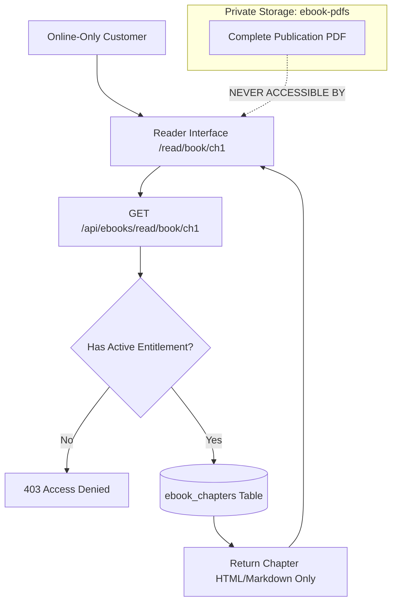

# KnowledgePaat — Phase 1: eBook System Integration Design
**Target Application:** KnowledgePaat ([https://www.knowledgepaat.com](https://www.knowledgepaat.com))  
**Architectural Scope:** Public Bookstore, Protected Reader, E-Commerce & Admin Subsystem  
**Status:** Approved for Implementation Planning  
**Date:** October 2026  

---

## 1. Routing & API Architecture

### 1.1 Route Strategy & Rationale
KnowledgePaat's current conventions separate the application into:
1. Public Marketing (`/`, `/jobs`, `/notes`, `/pricing`, `/about`, `/contact`).
2. Authenticated Student Portal (`/student/*`).
3. Isolated Admin Control Center (`/admin/*`).

For the eBook system, we recommend a **hybrid root-and-admin routing model**:
- **Public & Customer Root Routes**: `/e-books`, `/cart`, `/checkout`, `/my-books`, `/read/[bookId]/[chapterId]`.
- **Admin Management Routes**: `/admin/e-books`, `/admin/e-book-orders`.

#### Rationale for Root Routes over `/student/*`:
- **Audience Scope**: Books appeal to both existing students and external professional readers who may not need student-specific career features (e.g. resume builder or mock interviews).
- **SEO & Canonical URLs**: Clean URLs such as `knowledgepaat.com/e-books` and `knowledgepaat.com/read/...` provide superior search discoverability compared to deep nesting under `/student/`.
- **Existing Convention Compatibility**: Existing student users can access `/my-books` and the bookstore seamlessly via links added to [`StudentLayout.tsx`](file:///home/harsha/Documents/Documents/Project/KnowledgePaat/frontend/layouts/StudentLayout.tsx), without forcing non-student book buyers through student dashboard redirects.

---

### 1.2 Route Definition Matrix

| Route | Classification | Layout | Authentication Gate | Description |
|---|---|---|---|---|
| `/e-books` | Public | `PublicLayout` | Public (No login) | Book catalog grid (2 cards/row on desktop), category filter, search bar. |
| `/e-books/[bookId]` | Public | `PublicLayout` | Public (No login) | Book details, edition metadata, table of contents, sample reader drawer, ₹49 vs ₹99 comparison. |
| `/cart` | Public | `PublicLayout` | Public (No login) | Guest/Customer cart, plan selector (`read_online` vs `read_download`), 1 item per book enforcement, price summary. |
| `/checkout` | Customer | `PublicLayout` | **Verified Login Required** | Order review, server-verified pricing, ownership check, Razorpay checkout launcher. |
| `/my-books` | Customer | `PublicLayout` / `StudentLayout` | **Verified Login Required** | Customer purchase library, plan badges, "Read Now" buttons, PDF download buttons, reading progress. |
| `/read/[bookId]/[chapterId]` | Customer | Custom Reader | **Verified Login Required** | Distraction-free protected reader, chapter index sidebar, theme/font toggles, reading position autosave. |
| `/admin/e-books` | Admin | `AdminLayout` | **Admin Role Required** | Book catalog management, publication status, edition counts, creation button. |
| `/admin/e-books/new` | Admin | `AdminLayout` | **Admin Role Required** | Create new book, cover image upload, metadata input. |
| `/admin/e-books/[bookId]/edit` | Admin | `AdminLayout` | **Admin Role Required** | Edit book details, manage editions, upload publication PDFs. |
| `/admin/e-books/[bookId]/editions/[editionId]/chapters` | Admin | `AdminLayout` | **Admin Role Required** | Chapter authoring, Markdown/HTML editor, reordering, free sample toggle. |
| `/admin/e-book-orders` | Admin | `AdminLayout` | **Admin Role Required** | Purchase history, search by order ID or email, payment status filters, CSV export. |
| `/admin/e-book-orders/[orderId]` | Admin | `AdminLayout` | **Admin Role Required** | Order audit detail, payment gateway transaction ID, customer access override, refund action. |

---

### 1.3 Edge Proxy Middleware Adaptation
The edge middleware in [`frontend/utils/supabase/middleware.ts`](file:///home/harsha/Documents/Documents/Project/KnowledgePaat/frontend/utils/supabase/middleware.ts) must be extended with minimal changes:

```typescript
// Define protected customer eBook routes
const isCustomerProtectedRoute = 
  pathname.startsWith('/checkout') ||
  pathname.startsWith('/my-books') ||
  pathname.startsWith('/read');

// 1. Unauthenticated Visitor Handling
if (!user) {
  if (isCustomerProtectedRoute) {
    const url = request.nextUrl.clone();
    url.pathname = '/login';
    url.searchParams.set('redirectTo', pathname);
    return NextResponse.redirect(url);
  }
}

// 2. Prevent redirecting authenticated students away from public bookstore routes
// Existing check: if (isRootRoute || isStudentAuthRoute) -> redirect to /student/dashboard
// Public routes (/e-books, /cart, /checkout, /my-books, /read) remain accessible to logged-in users.
```

---

### 1.4 API Boundary & Endpoint Specifications

#### Public Endpoints
- `GET /api/ebooks`: Returns active published books with title, slug, author, cover URL, and starting price.
- `GET /api/ebooks/[bookId]`: Returns complete book metadata, current edition information, and chapter list with `is_free_sample` flags.
- `GET /api/ebooks/[bookId]/sample/[chapterId]`: Returns the full content body of a free sample chapter. Does not require authentication.

#### Customer Endpoints (Authenticated)
- `POST /api/ebooks/cart/validate`:
  - **Body**: `{ items: [{ bookId: string, plan: 'read_online' | 'read_download' }] }`
  - **Logic**: Looks up authoritative prices, checks existing user entitlements in `ebook_entitlements`, flags duplicate items or converts eligible items to the ₹50 upgrade delta.
  - **Returns**: Server-computed line items and total.
- `POST /api/ebooks/orders/create`:
  - **Body**: `{ items: [{ bookId: string, plan: 'read_online' | 'read_download' | 'upgrade_pdf' }] }`
  - **Logic**: Creates pending internal record in `ebook_orders` and registers order with Razorpay Gateway via [`createRazorpayOrder`](file:///home/harsha/Documents/Documents/Project/KnowledgePaat/frontend/lib/razorpay.ts).
- `POST /api/ebooks/orders/verify`:
  - **Body**: `{ internalOrderId, razorpay_order_id, razorpay_payment_id, razorpay_signature }`
  - **Logic**: Validates HMAC-SHA256 signature, updates order to `paid`, provisions rows in `ebook_entitlements`.
- `GET /api/ebooks/library`:
  - Returns authenticated user's unlocked books, plan types, and reading progress.
- `GET /api/ebooks/read/[bookId]/[chapterId]`:
  - **Authorization**: Checks `ebook_entitlements` for `customer_id = user.id` and `is_active = true`.
  - **Returns**: Chapter title, HTML/Markdown content body, word count, next/previous chapter IDs.
- `POST /api/ebooks/read/progress`:
  - **Body**: `{ bookId, editionId, chapterId, scrollPercent }`
  - **Logic**: Upserts reading progress in `ebook_reading_progress`.
- `POST /api/ebooks/download`:
  - **Authorization**: Strictly verifies user has `plan = 'read_download'` for the requested edition.
  - **Returns**: 60-second signed Supabase storage URL for the edition's PDF.

#### Admin Endpoints (Admin Role Required)
- `POST /api/admin/ebooks`: Create book record.
- `PUT /api/admin/ebooks/[bookId]`: Update metadata / publication status.
- `POST /api/admin/ebooks/[bookId]/upload`: Handle multipart upload for cover image (`ebook-covers` public bucket) or PDF publication (`ebook-pdfs` private bucket).
- `POST /api/admin/ebooks/[bookId]/chapters`: Add or update chapter content.
- `POST /api/admin/ebooks/entitlements/adjust`: Grant complimentary access or revoke access with logged `actor_id` and `reason`.
- `POST /api/admin/ebooks/orders/[orderId]/refund`: Mark order refunded, call Razorpay refund API, and revoke entitlements.

---

## 2. Database Schema & Data Relationships



### 2.1 Table Definitions & Constraints

```sql
-- 1. Master eBooks Table
CREATE TABLE IF NOT EXISTS public.ebooks (
  id UUID PRIMARY KEY DEFAULT gen_random_uuid(),
  slug TEXT NOT NULL UNIQUE,
  title TEXT NOT NULL,
  subtitle TEXT,
  author TEXT NOT NULL,
  description TEXT NOT NULL,
  category TEXT NOT NULL DEFAULT 'General',
  cover_image_url TEXT,
  status TEXT NOT NULL DEFAULT 'draft' CHECK (status IN ('draft', 'published', 'archived')),
  created_at TIMESTAMPTZ NOT NULL DEFAULT NOW(),
  updated_at TIMESTAMPTZ NOT NULL DEFAULT NOW()
);

-- 2. Book Editions Table (Enforces Versioning & Price Rules)
CREATE TABLE IF NOT EXISTS public.ebook_editions (
  id UUID PRIMARY KEY DEFAULT gen_random_uuid(),
  ebook_id UUID NOT NULL REFERENCES public.ebooks(id) ON DELETE CASCADE,
  edition_number INTEGER NOT NULL DEFAULT 1,
  version_name TEXT NOT NULL DEFAULT 'First Edition',
  pdf_storage_path TEXT, -- Stored strictly in private bucket 'ebook-pdfs'
  pdf_file_size_bytes BIGINT,
  page_count INTEGER,
  price_read_online NUMERIC(10, 2) NOT NULL DEFAULT 49.00 CHECK (price_read_online >= 0),
  price_read_download NUMERIC(10, 2) NOT NULL DEFAULT 99.00 CHECK (price_read_download >= 0),
  price_upgrade_pdf NUMERIC(10, 2) NOT NULL DEFAULT 50.00 CHECK (price_upgrade_pdf >= 0),
  is_current_edition BOOLEAN NOT NULL DEFAULT TRUE,
  created_at TIMESTAMPTZ NOT NULL DEFAULT NOW(),
  updated_at TIMESTAMPTZ NOT NULL DEFAULT NOW(),
  CONSTRAINT unique_ebook_edition UNIQUE (ebook_id, edition_number)
);

-- 3. Chapters Table (Reader Content & Sample Gating)
CREATE TABLE IF NOT EXISTS public.ebook_chapters (
  id UUID PRIMARY KEY DEFAULT gen_random_uuid(),
  edition_id UUID NOT NULL REFERENCES public.ebook_editions(id) ON DELETE CASCADE,
  chapter_index INTEGER NOT NULL,
  title TEXT NOT NULL,
  slug TEXT NOT NULL,
  content_body TEXT NOT NULL, -- Formatted Markdown / HTML content
  word_count INTEGER DEFAULT 0,
  is_free_sample BOOLEAN NOT NULL DEFAULT FALSE,
  created_at TIMESTAMPTZ NOT NULL DEFAULT NOW(),
  updated_at TIMESTAMPTZ NOT NULL DEFAULT NOW(),
  CONSTRAINT unique_edition_chapter_index UNIQUE (edition_id, chapter_index),
  CONSTRAINT unique_edition_chapter_slug UNIQUE (edition_id, slug)
);

-- 4. eBook Orders Table
CREATE TABLE IF NOT EXISTS public.ebook_orders (
  id UUID PRIMARY KEY DEFAULT gen_random_uuid(),
  order_number TEXT NOT NULL UNIQUE,
  customer_id UUID NOT NULL REFERENCES auth.users(id) ON DELETE RESTRICT,
  total_amount NUMERIC(10, 2) NOT NULL CHECK (total_amount >= 0),
  currency TEXT NOT NULL DEFAULT 'INR',
  payment_gateway TEXT NOT NULL DEFAULT 'razorpay',
  gateway_order_id TEXT,
  gateway_payment_id TEXT,
  payment_status TEXT NOT NULL DEFAULT 'pending' CHECK (payment_status IN ('pending', 'paid', 'failed', 'refunded')),
  order_status TEXT NOT NULL DEFAULT 'pending' CHECK (order_status IN ('pending', 'completed', 'cancelled')),
  settlement_status TEXT NOT NULL DEFAULT 'unsettled' CHECK (settlement_status IN ('unsettled', 'settled')),
  created_at TIMESTAMPTZ NOT NULL DEFAULT NOW(),
  updated_at TIMESTAMPTZ NOT NULL DEFAULT NOW()
);

-- 5. eBook Order Items Table
CREATE TABLE IF NOT EXISTS public.ebook_order_items (
  id UUID PRIMARY KEY DEFAULT gen_random_uuid(),
  order_id UUID NOT NULL REFERENCES public.ebook_orders(id) ON DELETE CASCADE,
  ebook_id UUID NOT NULL REFERENCES public.ebooks(id) ON DELETE RESTRICT,
  edition_id UUID NOT NULL REFERENCES public.ebook_editions(id) ON DELETE RESTRICT,
  plan TEXT NOT NULL CHECK (plan IN ('read_online', 'read_download', 'upgrade_pdf')),
  price NUMERIC(10, 2) NOT NULL CHECK (price >= 0),
  is_upgrade BOOLEAN NOT NULL DEFAULT FALSE,
  created_at TIMESTAMPTZ NOT NULL DEFAULT NOW()
);

-- 6. Customer Entitlements Table (Authoritative Digital Rights)
CREATE TABLE IF NOT EXISTS public.ebook_entitlements (
  id UUID PRIMARY KEY DEFAULT gen_random_uuid(),
  customer_id UUID NOT NULL REFERENCES auth.users(id) ON DELETE CASCADE,
  ebook_id UUID NOT NULL REFERENCES public.ebooks(id) ON DELETE RESTRICT,
  edition_id UUID NOT NULL REFERENCES public.ebook_editions(id) ON DELETE RESTRICT,
  plan TEXT NOT NULL CHECK (plan IN ('read_online', 'read_download')),
  order_id UUID REFERENCES public.ebook_orders(id) ON DELETE SET NULL,
  grant_type TEXT NOT NULL DEFAULT 'purchase' CHECK (grant_type IN ('purchase', 'upgrade', 'complimentary', 'admin_override')),
  granted_by UUID REFERENCES auth.users(id) ON DELETE SET NULL, -- Admin ID for manual grants
  grant_reason TEXT,
  is_active BOOLEAN NOT NULL DEFAULT TRUE,
  created_at TIMESTAMPTZ NOT NULL DEFAULT NOW(),
  updated_at TIMESTAMPTZ NOT NULL DEFAULT NOW(),
  CONSTRAINT unique_customer_edition_access UNIQUE (customer_id, ebook_id, edition_id)
);

-- 7. Reading Progress & Bookmarks Table
CREATE TABLE IF NOT EXISTS public.ebook_reading_progress (
  id UUID PRIMARY KEY DEFAULT gen_random_uuid(),
  customer_id UUID NOT NULL REFERENCES auth.users(id) ON DELETE CASCADE,
  ebook_id UUID NOT NULL REFERENCES public.ebooks(id) ON DELETE CASCADE,
  edition_id UUID NOT NULL REFERENCES public.ebook_editions(id) ON DELETE CASCADE,
  last_chapter_id UUID NOT NULL REFERENCES public.ebook_chapters(id) ON DELETE CASCADE,
  scroll_percent NUMERIC(5, 2) DEFAULT 0.0 CHECK (scroll_percent >= 0 AND scroll_percent <= 100),
  completed_at TIMESTAMPTZ,
  updated_at TIMESTAMPTZ NOT NULL DEFAULT NOW(),
  CONSTRAINT unique_customer_reading_progress UNIQUE (customer_id, ebook_id, edition_id)
);

-- 8. Audit Logging Table
CREATE TABLE IF NOT EXISTS public.ebook_audit_logs (
  id UUID PRIMARY KEY DEFAULT gen_random_uuid(),
  actor_id UUID REFERENCES auth.users(id) ON DELETE SET NULL,
  action TEXT NOT NULL,
  entity_type TEXT NOT NULL,
  entity_id TEXT NOT NULL,
  metadata JSONB NOT NULL DEFAULT '{}'::jsonb,
  created_at TIMESTAMPTZ NOT NULL DEFAULT NOW()
);
```

---

## 3. Access-Control Matrix

| Action / Capability | Guest Visitor | Authenticated Customer | Admin | Webhook Worker |
|---|:---:|:---:|:---:|:---:|
| Browse bookstore catalog (`/e-books`) | 🟢 Allowed | 🟢 Allowed | 🟢 Allowed | ⚪ N/A |
| View book details & table of contents | 🟢 Allowed | 🟢 Allowed | 🟢 Allowed | ⚪ N/A |
| Read free sample chapters | 🟢 Allowed | 🟢 Allowed | 🟢 Allowed | ⚪ N/A |
| Add book to cart | 🟢 Allowed (localStorage) | 🟢 Allowed (localStorage) | 🟢 Allowed | ⚪ N/A |
| Initiate checkout (`/checkout`) | 🔴 Redirect to `/login` | 🟢 Allowed | 🟢 Allowed | ⚪ N/A |
| Read paid chapters in online reader | 🔴 401 Unauthorized | 🟢 If `ebook_entitlements` active | 🟢 Allowed | ⚪ N/A |
| Download complete PDF | 🔴 401 Unauthorized | 🟢 If plan is `read_download` | 🟢 Allowed | ⚪ N/A |
| Purchase PDF upgrade (+₹50) | 🔴 Redirect to `/login` | 🟢 If plan is `read_online` | 🟢 Allowed | ⚪ N/A |
| Create / Edit books & chapters | 🔴 403 Forbidden | 🔴 403 Forbidden | 🟢 Allowed | ⚪ N/A |
| Upload publication PDFs | 🔴 403 Forbidden | 🔴 403 Forbidden | 🟢 Allowed | ⚪ N/A |
| View customer order history | 🔴 403 Forbidden | 🔴 403 Forbidden | 🟢 Allowed | ⚪ N/A |
| Grant complimentary access | 🔴 403 Forbidden | 🔴 403 Forbidden | 🟢 Allowed (Logged) | ⚪ N/A |
| Authoritative payment capture | ⚪ N/A | ⚪ N/A | ⚪ N/A | 🟢 Allowed (HMAC) |

---

## 4. State Machines & Transitions

### 4.1 Order State Transitions


### 4.2 Entitlement Lifecycle


### 4.3 Recovery & Resiliency Protocols
1. **Browser Disconnect during Payment**:
   - If a customer's payment succeeds on Razorpay but the browser window closes before the verification API callback executes:
   - The verified webhook endpoint [`/api/payments/razorpay/webhook`](file:///home/harsha/Documents/Documents/Project/KnowledgePaat/frontend/app/api/payments/razorpay/webhook/route.ts) catches `payment.captured` or `order.paid`, matches `internalOrderId`, marks the order `paid`, and provisions `ebook_entitlements`.
   - When the user logs back in and visits `/my-books`, their purchase is already unlocked.
2. **Duplicate Webhook Delivery**:
   - Webhook checks existing order status: If `payment_status === 'paid'`, it acknowledges receipt (`200 OK`) and exits immediately without creating duplicate entitlements.
3. **Upgrade Handling & Existing Ownership**:
   - Before charging, the order creation endpoint queries `ebook_entitlements`.
   - If the user already owns `read_download` for the requested edition, the order is blocked with a 400 error.
   - If the user owns `read_online` and adds the same book, the server automatically charges only the ₹50 upgrade delta, and on verification elevates the entitlement to `read_download`.

---

## 5. Upload & Content Delivery Architecture

### 5.1 Storage Bucket Configuration
1. **`ebook-covers` Bucket**:
   - Public read access.
   - Allowed MIME types: `image/jpeg`, `image/png`, `image/webp`.
   - Max file size: 2 MB.
   - Used for catalog thumbnails and book detail hero displays.
2. **`ebook-pdfs` Bucket**:
   - **Strictly private**. Public access disabled (`public = false`).
   - Allowed MIME types: `application/pdf`.
   - Max file size: 100 MB.
   - File path convention: `editions/{editionId}/publication.pdf`.
   - Direct download URLs are NEVER shared with clients. Only 60-second signed URLs are generated via `/api/ebooks/download` after verifying active `read_download` plan.

---

## 6. Reader Content Protection Architecture

To satisfy the strict business rule: *"Online-only buyers must not receive the complete PDF through the reader"*:



1. **Structured Chapter Decoupling**: Complete books are never sent as a whole document. Content is stored chapter-by-chapter in `ebook_chapters.content_body`.
2. **Isolated PDF Storage**: The complete PDF file is stored exclusively in the private bucket and is referenced only when generating downloads for `read_download` customers.
3. **Chunked API Delivery**: The reader fetches one chapter at a time. The API inspects the customer's session and verifies active entitlement for that book and edition before streaming the text.
4. **Anti-Scraping Protection**:
   - Rapid sequential requests across chapters are rate-limited via [`rateLimit.ts`](file:///home/harsha/Documents/Documents/Project/KnowledgePaat/frontend/lib/rateLimit.ts).
   - Chapter content is sanitized server-side before rendering.

---

## 7. Policy Decisions Needing Stakeholder Resolution

Before deploying Phase 5 and Phase 7, the following business policies require explicit stakeholder confirmation:

1. **Future Editions Policy**:
   - *Current Implementation Decision*: Entitlements are strictly tied to `edition_id`. Customers who buy Edition 1 receive Edition 1 permanently.
   - *Open Decision*: Should customers receive free digital updates to subsequent editions (e.g. Edition 2), or will new editions be sold as separate purchases or discounted upgrades?
2. **Refund Window & Revocation Policy**:
   - *Current Implementation Decision*: Refunds revoke active entitlements immediately.
   - *Open Decision*: What is the allowable refund window (e.g., within 48 hours if fewer than 2 chapters read, or zero refunds once any content is accessed)?
3. **Digital Watermarking**:
   - *Open Decision*: Should generated PDFs include dynamic buyer stamping (e.g., *"Licensed to customer@email.com - Order #KP-EB-1234"*) on page margins to discourage unauthorized sharing?
4. **Transactional Email Provider Selection**:
   - *Open Decision*: Select an official transactional email vendor (Resend, SendGrid, or AWS SES) to handle purchase receipts and email recovery links.
