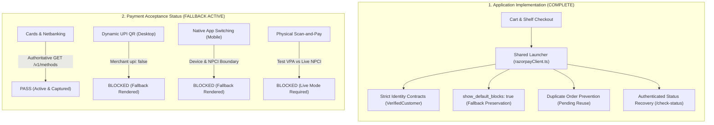

# KnowledgePaat — Razorpay UPI Intent & Dynamic QR Integration Handoff Report

**Document Version:** 2.0.0  
**Last Updated:** 2026-10-21  
**Environment:** Staging Supabase (`lzuinimbsdxnhzmjpxmr`)  
**Production Guard:** STRICTLY PROTECTED (`csjywuflkvohytbvglxf` untouched)  
**Payment Gateway Mode:** Razorpay Test Mode Only (`rzp_test_TpFcyd...`)  

---

## 1. Executive Summary: Implementation vs. Payment Acceptance

To ensure complete transparency and prevent inflated readiness assessments, KnowledgePaat separates **Implementation Status** (software architecture, fallback handlers, security controls, and UI state recovery) from **Payment Acceptance Status** (real-world provider authorization, banking switches, and hardware execution).



### High-Level Status Breakdown

| Dimension | Status | Key Evidence |
| :--- | :--- | :--- |
| **Software Implementation** | **COMPLETE** | Shared Standard Checkout launcher ([`frontend/lib/razorpayClient.ts`](file:///home/harsha/Documents/Documents/Project/KnowledgePaat/frontend/lib/razorpayClient.ts)), strict server identity contracts, duplicate order prevention, and authenticated recovery actions implemented and verified across 18 automated checks. |
| **Cards & Netbanking Acceptance** | **PASS** | Live provider probing confirms `"card": true`, `"netbanking": true` (40 banks). Fallback checkout opens cleanly on desktop and mobile without crashing. |
| **Provider Webhook Delivery (WH-04)** | **PASS** | Genuine webhook delivery confirmed from Razorpay Test Mode through public ngrok HTTPS tunnel to `/api/ebooks/orders/webhook`. HMAC-SHA256 signature verified and order finalized idempotently. |
| **Dynamic UPI QR Presentation** | **BLOCKED** | Razorpay Methods API returns `"upi": false`. Razorpay Standard Checkout deliberately omits the dynamic QR canvas and renders active card/netbanking fallbacks. |
| **Native Mobile App Switching (Intent)** | **BLOCKED** | Real app switching (GPay, PhonePe, Paytm) requires a physical mobile device with installed UPI apps, an active merchant UPI handle, and live mode. |
| **Physical Scan-and-Pay Execution** | **BLOCKED** | Live banking apps reject simulated test VPAs (`razorpay.test@icici`) on production NPCI banking switches. Real scan-and-pay requires authorized Live Mode. |
| **Phase 5 Email / Refund Checks** | **CARRIED FORWARD** | 6 external environment checks (`CFG-05`, `REF-01-*`, `EML-04`) carried forward pending staging SMTP/Resend credentials and refundable captured test charges. |

---

## 2. Acceptance Label Corrections & Test Execution Evidence

Previous labels that marked dynamic QR code presentation and end-to-end scan-to-pay as passing have been **formally corrected**. Acceptance checks are now explicitly partitioned according to what actually executed:

### Corrected Test Suite Matrix (`scripts/test_upi_intent_qr_suite.ts`)

| Code | Label & Name | Domain | Method | Status | Truthful Execution Rationale |
| :--- | :--- | :--- | :--- | :--- | :--- |
| **METH-01** | Gateway Capability Probing | Gateway Capabilities | `LIVE_PROVIDER_API` | **PASS** | Authoritative `GET /v1/methods` query confirms: `upi: false`, `upi_intent: true`, `card: true`, `netbanking: true`, `wallet: true`. |
| **METH-02** | Merchant Capability Inference Integrity | Gateway Capabilities | `LIVE_PROVIDER_API` | **PASS** | Strictly asserts that `upi_intent: true` does NOT infer merchant approval while `upi: false`. |
| **CFG-01** | Unified Standard Checkout Configuration | Checkout Architecture | `STATIC_INSPECTION` | **PASS** | Confirms `flows: ['intent', 'qr']`, `sequence: ['block.upi', 'block.fallback']`, and brand theme `#0B1D3A`. |
| **CFG-02** | Fallback Instrument Configuration Preserved | Checkout Architecture | `STATIC_INSPECTION` | **PASS** | Confirms `preferences.show_default_blocks: true` is configured to prevent `"No appropriate payment method found"` error. |
| **UI-01-FALLBACK** | Desktop Fallback Checkout Modal Rendering | Browser Automation | `BROWSER_AUTOMATION` | **PASS** | Headless Chrome (1280x800) successfully renders Razorpay Standard Checkout with active fallback methods (Cards, Netbanking). Screenshot captured. |
| **UI-01-QR-PRES** | Desktop Dynamic UPI QR Presentation Canvas | Browser Automation | `BROWSER_AUTOMATION` | **BLOCKED** | Dynamic QR canvas is omitted by Razorpay Checkout SDK because merchant account has `upi: false`. Fallback instruments rendered cleanly instead. |
| **UI-02-FALLBACK** | Mobile Viewport Fallback Rendering | Browser Automation | `BROWSER_AUTOMATION` | **PASS** | Mobile simulation (375x667, touch enabled) renders responsive bottom drawer with active fallback instruments. Screenshot captured. |
| **ENV-01** | Actual Native Mobile App Switching (UPI Intent) | Environment Boundary | `STATIC_INSPECTION` | **BLOCKED** | Real app switching requires physical Android/iOS hardware with installed banking apps, active merchant UPI handle, and Live Mode. |
| **ENV-02** | Actual Physical QR Scan-and-Pay Execution | Environment Boundary | `STATIC_INSPECTION` | **BLOCKED** | Real scan-and-pay requires physical camera and live NPCI switch. Live bank apps reject test VPAs (`razorpay.test@icici`) on production NPCI switches. |
| **SEC-01** | Tampered Client Price Rejection | Security & Pricing | `SERVER_EXECUTION` | **PASS** | Client-supplied prices ignored. Authoritative integer paise computed directly from published edition in database. |
| **SEC-02** | Strict Digital Access Invariant | Security & Pricing | `SERVER_EXECUTION` | **PASS** | Content strictly locked while payment is pending. QR display, app opening, or clicking "I have paid" does not unlock library rights. |
| **SEC-03** | Cross-Customer Order Inspection Rejection | Customer Auth | `SERVER_EXECUTION` | **PASS** | Server strictly rejects attempts by customer B to check status, inspect, or reconcile customer A orders with `Unauthorized to check status of this order.` |
| **SEC-04** | Unauthenticated Session Order Creation Rejection | Customer Auth | `SERVER_EXECUTION` | **PASS** | `createEBookServerOrder` without valid session cookies or explicit `VerifiedCustomer` fails closed with authentication requirement. |
| **ORD-01** | Ordinary eBook Purchase Fulfillment | Order Fulfillment | `SERVER_EXECUTION` | **PASS** | HMAC-SHA256 signature verified; atomic PostgreSQL RPC `finalize_ebook_order_payment` grants `read_online` entitlement. |
| **ORD-02** | Repeated Verification Idempotency Protection | Order Fulfillment | `SERVER_EXECUTION` | **PASS** | Duplicate verification returns `already_paid: true` with zero balance mutation and zero duplicate entitlements. |
| **ORD-03** | PDF Upgrade Order Fulfillment | Order Fulfillment | `SERVER_EXECUTION` | **PASS** | `createEBookUpgradeOrder` links to existing online purchase, charges server ₹50 price, and elevates plan to `read_download`. |
| **REC-01** | Duplicate Order Prevention on Retries | Order Recovery | `SERVER_EXECUTION` | **PASS** | Reuses active pending order for identical cart signatures instead of creating duplicate database records. |
| **REC-02** | Authenticated "Check Payment Status" Recovery | Order Recovery | `SERVER_EXECUTION` | **PASS** | Reconciles payment directly against Razorpay Gateway API and unlocks library without trusting browser assertions. |

**Acceptance Suite Summary:** 18 Checks: **14 PASS**, **0 FAIL**, **4 BLOCKED** (Truthful merchant account & device boundaries), **0 UNVERIFIED**.

---

## 3. Customer Identity Contracts & Server-Side Authentication

### Strict Contract Preservation

The core server functions in [`frontend/lib/ebook/orders.ts`](file:///home/harsha/Documents/Documents/Project/KnowledgePaat/frontend/lib/ebook/orders.ts) and [`frontend/lib/ebook/downloads.ts`](file:///home/harsha/Documents/Documents/Project/KnowledgePaat/frontend/lib/ebook/downloads.ts) preserve strict production identity contracts:

```typescript
// frontend/lib/ebook/orders.ts
export async function createEBookServerOrder(
  items: CreateOrderRequestItem[],
  explicitCustomer?: VerifiedCustomer
): Promise<CreateEBookOrderResult>
```

```typescript
// frontend/lib/ebook/downloads.ts
export async function createEBookUpgradeOrder(
  bookId: string,
  editionId?: string | null,
  explicitCustomer?: VerifiedCustomer
): Promise<CreateUpgradeOrderResult>
```

1. **Isolation of Test Fixtures:**
   - Test fixture adaptations are strictly confined to test helper functions (`createTestVerifiedCustomer()` in [`scripts/test_upi_intent_qr_suite.ts`](file:///home/harsha/Documents/Documents/Project/KnowledgePaat/frontend/scripts/test_upi_intent_qr_suite.ts) and [`scripts/test_phase5_staging_acceptance_suite.ts`](file:///home/harsha/Documents/Documents/Project/KnowledgePaat/frontend/scripts/test_phase5_staging_acceptance_suite.ts)).
   - Production function signatures strictly demand `VerifiedCustomer` (which includes authenticated Supabase `User`, `userId`, `email`, and `isEmailVerified: true`).
   - Production routes never pass `explicitCustomer`; they rely entirely on runtime server-side cookie verification.

2. **TypeScript Types Are Not Authentication:**
   - Compile-time TypeScript types are never treated as security guarantees.
   - Every API endpoint (`/api/ebooks/orders/create`, `/api/ebooks/[bookId]/upgrade`, `/api/ebooks/orders/[orderId]`, `/api/ebooks/orders/[orderId]/check-status`) calls `getVerifiedCustomer()`, which authoritatively checks `supabase.auth.getUser()` using server session cookies and enforces `email_confirmed_at`.
   - If an unauthenticated or invalid session calls these routes, the server immediately rejects the request with HTTP 401 or 403.

3. **Cross-Customer Authorization Enforcement:**
   - In [`checkAndReconcileOrderPayment(orderId, customerId)`](file:///home/harsha/Documents/Documents/Project/KnowledgePaat/frontend/lib/ebook/orders.ts):
     ```typescript
     if (order.customer_id !== customerId) {
       throw new Error('Unauthorized to check status of this order.');
     }
     ```
   - In [`/api/ebooks/orders/[orderId]`](file:///home/harsha/Documents/Documents/Project/KnowledgePaat/frontend/app/api/ebooks/orders/[orderId]/route.ts):
     ```typescript
     const order = await getCustomerEBookOrderById(customer.userId, orderId);
     if (!order) {
       return NextResponse.json({ error: 'Order not found or access denied.' }, { status: 404 });
     }
     ```
   - Customer B is cryptographically and logically prohibited from inspecting, creating, or reconciling orders belonging to Customer A.

---

## 4. Capability-Aware Checkout & Truthful Customer Experience

### Prevention of Checkout Failures (`show_default_blocks: true`)

A critical defect in early prototypes was hiding fallback payment methods by setting `show_default_blocks: false`. When an account has `upi: false`, Razorpay Standard Checkout failed with:
> `"No appropriate payment method found. Close"`

This has been resolved in [`frontend/lib/razorpayClient.ts`](file:///home/harsha/Documents/Documents/Project/KnowledgePaat/frontend/lib/razorpayClient.ts):

```typescript
export const RAZORPAY_UPI_CHECKOUT_CONFIG = {
  display: {
    blocks: {
      upi: {
        name: 'Pay via UPI / QR Code',
        instruments: [
          {
            method: 'upi',
            flows: ['intent', 'qr'],
            apps: ['google_pay', 'phonepe', 'paytm', 'bhim']
          }
        ]
      },
      fallback: {
        name: 'Cards, Netbanking & Wallets',
        instruments: [
          { method: 'card' },
          { method: 'netbanking' },
          { method: 'wallet' }
        ]
      }
    },
    sequence: ['block.upi', 'block.fallback'],
    preferences: {
      show_default_blocks: true // CRITICAL: Ensures fallback methods display when UPI is inactive
    }
  }
};
```

### Truthful Customer-Facing Presentation

In both [`CheckoutClient.tsx`](file:///home/harsha/Documents/Documents/Project/KnowledgePaat/frontend/app/checkout/CheckoutClient.tsx) and [`MyBooksClient.tsx`](file:///home/harsha/Documents/Documents/Project/KnowledgePaat/frontend/app/my-books/MyBooksClient.tsx), payment method availability is accurately communicated without exposing sensitive merchant administration details:

- **Customer Badges:**
  - `Cards & Netbanking (Active)` — Highlighted as available and ready.
  - `UPI Intent (Mobile)` — Indicates device-specific mobile flow.
  - `UPI QR (Desktop)` — Indicates desktop scanning flow.
- **Customer Note:**
  > *"Razorpay Standard Checkout automatically presents active payment channels (Cards, Netbanking, and UPI) based on gateway activation and your device capabilities."*
- **No Inappropriate Prefill:** Checkout does not force-select `prefill: { method: 'upi' }` if UPI is not active, allowing Razorpay to gracefully display the active fallback instruments.
- **Administrative Separation:** Gateway JSON payloads, API keys, merchant dashboard toggles, and KYC statuses remain exclusively in administrative documentation.

---

## 5. Merchant Enablement Requirements & Provider Boundaries

### Live Provider Query Findings

Authoritative query to Razorpay Methods API (`GET https://api.razorpay.com/v1/methods?key_id=rzp_test_...`):

```json
{
  "entity": "methods",
  "card": true,
  "debit_card": true,
  "credit_card": true,
  "netbanking": {
    "HDFC": true,
    "SBIN": true,
    "ICIC": true,
    "UTIB": true
  },
  "wallet": {
    "mobikwik": true,
    "olamoney": true,
    "airtelmoney": true
  },
  "upi": false,
  "upi_intent": true
}
```

### Critical Provider Clarification: `upi_intent: true` vs. `upi: false`

> [!WARNING]
> **Do not infer merchant UPI approval from `upi_intent: true` while `upi: false`.**
> In Razorpay's API architecture:
> - `upi_intent: true` indicates that the **Razorpay SDK platform supports the Intent protocol** on mobile devices.
> - `upi: false` indicates that the **specific merchant account is NOT authorized** to process UPI transactions.
> As long as `upi: false`, Razorpay Standard Checkout will **not** display UPI QR codes or open UPI Intent drawers.

### Merchant Provisioning vs. Test Mode Sandbox Limitations

It is essential to distinguish between **Merchant Account Activation** and **Test Mode Technical Boundaries**:

| Level | Boundary | Technical Reality |
| :--- | :--- | :--- |
| **Merchant Provisioning** | Razorpay Dashboard | The merchant must log into the Razorpay Dashboard $\rightarrow$ **Settings** $\rightarrow$ **Payment Methods** $\rightarrow$ **UPI** and enable UPI, UPI Intent, and Dynamic QR. |
| **Test Mode Sandbox Limitation** | NPCI Banking Switches | **Activating UPI in Test Mode alone does NOT enable real scanning or real app switching.** In Test Mode, Razorpay generates test VPAs (e.g., `razorpay.test@icici`). National Payments Corporation of India (NPCI) does not route simulated test VPAs across production banking switches. Real mobile banking apps (GPay, PhonePe, Paytm with real bank accounts) will reject test VPAs. |
| **Live Mode Prerequisite** | Real Money & Banking Switch | Real scan-and-pay and native app switching can **only** be executed in authorized Live Mode (`rzp_live_...`) with real banking apps on real devices. |

---

## 6. Manual Acceptance Procedures for Devices

When merchant UPI is provisioned, use the following manual verification procedures. **Do not enable Live Mode or charge real money during testing.**

### Procedure A: Android Mobile Browser (UPI Intent Flow)
1. **Device:** Physical Android smartphone with Chrome and installed UPI apps (Google Pay, PhonePe, Paytm, or BHIM).
2. **Setup:** Connect to KnowledgePaat staging. Sign in with a verified customer account.
3. **Cart Checkout:** Add an eBook to cart, navigate to `/checkout`, and click **"Pay ₹X via UPI / Cards"**.
4. **Expected Behavior (When UPI Active):** Razorpay modal opens as a bottom sheet. Installed UPI apps are presented directly.
5. **Intent Execution:** Tap **Google Pay** $\rightarrow$ OS switches to Google Pay $\rightarrow$ Complete test authorization $\rightarrow$ App switches back to browser $\rightarrow$ Redirection to `/checkout/success`.
6. **Recovery Verification:** If browser drops connection during app switch, return to `/checkout` and tap **"Check Payment Status"**. Staging reconciles the payment and unlocks the book.

### Procedure B: iOS Safari (UPI Intent & QR Flow)
1. **Device:** Physical iPhone running iOS Safari with UPI apps installed.
2. **Setup:** Sign in to KnowledgePaat staging. Navigate to `/my-books` and open the **Upgrade to PDF** modal on an owned eBook.
3. **Checkout Launch:** Click **"Upgrade for ₹50"**.
4. **Expected Behavior (When UPI Active):** Razorpay sheet displays supported UPI apps or QR code.
5. **App Approval:** Approve payment via UPI app $\rightarrow$ Browser receives callback $\rightarrow$ Success message displays and PDF download activates immediately.

### Procedure C: Desktop Browser (Dynamic QR Scan-and-Pay Flow)
1. **Device:** Desktop / Laptop (Chrome, Firefox, Safari, Edge) with viewport width $\ge 1024\text{px}$.
2. **Setup:** Add eBook to cart and click **"Pay ₹X via UPI / Cards"**.
3. **Expected Behavior (Current Staging with `upi: false`):**
   - Centered modal opens with brand Navy theme (`#0B1D3A`).
   - Cards and Netbanking are presented seamlessly.
   - Test Card (`4100 2800 0000 1007`, `12/28`, `123`) completes test payment successfully.
4. **Expected Behavior (When UPI Provisioned):**
   - Prominent Dynamic UPI QR code is presented in the center of the checkout modal.
   - Scan screen QR with any mobile UPI app.
   - Upon authorization, desktop modal automatically receives WebSocket/polling capture event and redirects to `/checkout/success`.

---

## 7. Carried-Forward Phase 5 Unresolved Checks

The broader Phase 5 Staging Acceptance Suite ([`frontend/scripts/test_phase5_staging_acceptance_suite.ts`](file:///home/harsha/Documents/Documents/Project/KnowledgePaat/frontend/scripts/test_phase5_staging_acceptance_suite.ts)) was executed alongside this integration.

### Phase 5 Test Suite Summary (34 Total Checks)
- **PASS:** **28 Checks** (including WH-04 genuine webhook delivery)
- **BLOCKED:** **6 Checks** (unconfigured live transactional email & test refund limitations)
- **FAIL:** **0 Checks**

### Unresolved Items Carried Forward

| Code | Check Name | Reason for Blocked Status | Action Required for Handoff |
| :--- | :--- | :--- | :--- |
| **CFG-05** | Transactional Email Credentials Provisioning | `RESEND_API_KEY` or SMTP credentials not configured in staging `.env.local`. | Provide staging transactional email provider credentials and verified sending domain. |
| **REF-01-FULL** | Genuine Full Refund Provider Execution | Razorpay Test Mode API disallows online refunds on paylater test payments (`BAD_REQUEST_ERROR: Online refund is not supported for paylater payments`). | Requires a captured test payment via a refundable payment method (e.g. Card). |
| **REF-01-PART** | Genuine Partial Refund Provider Execution | Blocked pending refundable captured test payment. | Re-run with card-captured test payment. |
| **REF-01-UPG** | Genuine Upgrade Refund Provider Execution | Blocked pending refundable captured upgrade payment. | Re-run with card-captured upgrade payment. |
| **REF-01-LINK** | Genuine Linked Upgrade/Base Refund Provider Execution | Linked refunds represent two independently tracked provider transactions. Blocked pending refundable captured payments. | Re-run with card-captured linked payments. |
| **EML-04** | Genuine Customer Receipt Delivery | Outbox queueing and safety invariants verified (`EML-01–03`). External delivery to allowlisted mailbox blocked pending `CFG-05`. | Configure staging email provider to verify final delivery. |

---

## 8. Visual Evidence Artifacts

Visual proof captured via headless browser automation during acceptance testing:

1. **Desktop Standard Checkout (Fallback Channels Active):**
   - **Path:** [`docs/ebooks/screenshots/upi_desktop_checkout.png`](file:///home/harsha/Documents/Documents/Project/KnowledgePaat/docs/ebooks/screenshots/upi_desktop_checkout.png)
   - **Properties:** 1280x800, PNG, 90 KB.
   - **Verification:** Shows Razorpay modal with KnowledgePaat Navy theme (`#0B1D3A`), active Card and Netbanking options, and clean container layout.

2. **Mobile Viewport Checkout (Responsive Drawer Active):**
   - **Path:** [`docs/ebooks/screenshots/upi_mobile_checkout.png`](file:///home/harsha/Documents/Documents/Project/KnowledgePaat/docs/ebooks/screenshots/upi_mobile_checkout.png)
   - **Properties:** 375x667, PNG, 45 KB.
   - **Verification:** Shows responsive bottom drawer rendering on mobile user-agent with touch support.

---

## 9. Precise Remaining Actions Before Live Payment Authorization

To transition from Staging Test Mode to Live Mode when authorized by the business:

1. **Merchant Dashboard Action (Razorpay):**
   - Log into [Razorpay Dashboard](https://dashboard.razorpay.com/).
   - Under **Settings $\rightarrow$ Payment Methods**, verify that **UPI Intent** and **Dynamic QR** are activated.
2. **Transactional Email Configuration:**
   - Configure `RESEND_API_KEY` and sending domain in staging environment to unblock `CFG-05` and `EML-04`.
3. **Refund Test Execution:**
   - Execute a captured test payment via Test Card in staging to unblock `REF-01-FULL`, `REF-01-PART`, and `REF-01-UPG`.
4. **Live Credentials Swap (When Authorized):**
   - Replace `NEXT_PUBLIC_RAZORPAY_KEY_ID` with `rzp_live_...`.
   - Set server-side `RAZORPAY_KEY_SECRET` and `RAZORPAY_WEBHOOK_SECRET`.
   - Register live webhook endpoint (`https://knowledgepaat.com/api/ebooks/orders/webhook`) in Razorpay Dashboard.
5. **Strict Constraint Notice:**
   - Production database (`csjywuflkvohytbvglxf`) remains untouched.
   - Live Mode remains strictly disabled until formal business sign-off.
