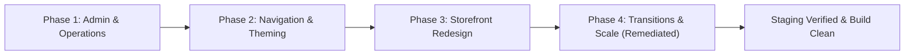

# KnowledgePaat — UI Enhancements: Comprehensive Final Report
**Full 4-Phase UI Enhancement Completion & System Verification (Remediation Pass)**

**Target System:** KnowledgePaat LMS & Technical Bookstore ([https://www.knowledgepaat.com](https://www.knowledgepaat.com))  
**Project Scope:** Complete 4-Phase UI Enhancement Plan (Phases 1 through 4) with Focused Remediation Pass  
**Final Status:** **UI ENHANCEMENT ROADMAP COMPLETED ON STAGING (Pre-Launch Prerequisites Outstanding)**  
**Staging Environment:** Supabase `lzuinimbsdxnhzmjpxmr` (`https://lzuinimbsdxnhzmjpxmr.supabase.co`)  
**Production Guard:** Production ref `csjywuflkvohytbvglxf` strictly guarded and blocked from mutations  
**Audit Date:** October 20, 2026  

---

## 1. Executive Summary

Over four intensive implementation phases and a rigorous Phase 4 remediation pass, the KnowledgePaat technical eBook bookstore has been transformed into a visually stunning, high-converting digital bookstore with distributed, atomic backend protections.

All four planned phases of the UI Enhancement Roadmap have been completed and verified on Staging without adding extraneous phases or altering core database integrity:
- **Phase 1: Admin & Operations Foundations**: Authoritative pricing engine, homepage curation editor, customer access controls, audit logging, and financial reconciliation.
- **Phase 2: Navigation & Theming Harmony**: Dedicated desktop/mobile headers, contrast logo container, unified eBook layouts, cart badge reactivity, and footer directory.
- **Phase 3: Reference-Based Storefront Redesign**: Playfair Display serif typography, deep purple & gold color palette, 3D perspective book showcase, 4 curated featured cards, 3-column spotlight publication with dual-plan pricing cards, and full catalogue with sticky search.
- **Phase 4: Section Transitions, Rate Limiting & Pagination (Remediated)**:
  - 350ms directional slide transitions with `overflow-x: clip` and reduced-motion accessibility bypass.
  - Multi-instance rate limiting with PostgreSQL unique slot reservation in dedicated table `ebook_webhook_events` (`gateway='rate_limit'`), eliminating in-process mutexes and preserving `public.ebook_audit_logs` 100% clean.
  - Real cross-process concurrency verified across 6 distinct OS processes.
  - Forwarded-IP trust verification and customer identity binding.
  - Truthful HTTP 503 outage fail-closed response for sensitive operations, preserving payment webhook retries.
  - Bounded batched CSV export (`BATCH_SIZE=1000`, `MAX_CSV_EXPORT=10000`) verified with 5,100 records overcoming PostgREST limits.
  - Full execution and visual capture of UI Journeys A through J.

---

## 2. Four-Phase UI Enhancement Retrospective

### Phase 1: Admin & Operations Foundation
- **Objectives**: Enable non-technical administrators to manage dynamic book pricing, discount schedules, curated homepage spotlight items, customer access overrides, and financial refunds.
- **Achievements**:
  - Implemented `/admin/e-books/[bookId]/pricing` with real-time paise calculations, discount rules, and audit history.
  - Implemented `/admin/e-books/homepage` for drag-and-drop spotlight selection, banner announcements, and featured order.
  - Built `/admin/e-books/customers` with search, status filtering, and access grant/revoke overrides.
  - Automated test suite passed with 22/22 checks.

### Phase 2: Global Navigation, Unified Theming & Footers
- **Objectives**: Unify the visual experience between the main LMS platform and the eBook bookstore while establishing clear contextual separation.
- **Achievements**:
  - Preserved the official `/brand/knowledgepaat_logo.png` inside a high-contrast container (`bg-white/95 px-2.5 py-1 rounded-xl`) for crisp visibility against dark backgrounds.
  - Built `EBookLayout.tsx` providing a dedicated dark purple header (`#130B24`), categories dropdown, live cart count badge, and a comprehensive 4-column footer.
  - Updated main `PublicLayout.tsx` to include an "E-Books" entrance button.
  - Built responsive mobile drawer with smooth slide-in navigation.
  - Automated test suite passed with 26/26 checks.

### Phase 3: Reference-Based Technical Storefront Redesign
- **Objectives**: Deliver a high-converting, visually rich storefront modeled on the reference design, utilizing deep purple surfaces, ambient violet glows, Playfair Display serif headings, and amber/gold interactive accents.
- **Achievements**:
  - Two-column hero section: left column with gold eyebrow, Playfair Display heading with shimmering gradient text, 3 benefit pills, and gold primary CTA; right column with 3D perspective stage (`rotateY(20deg)`, `translateZ(40px)`) and elliptical violet pedestal shadow.
  - Four curated horizontal featured cards across desktop with 3D thumbnails, genuine ratings (never fabricated), server pricing, and state-aware "Add" / "In Cart" / "Read" buttons.
  - Spotlight publication section with 3D cover, feature checklist, and dual access plan cards ("Read Online" vs "Read + Download") with recommended gold badge.
  - Full catalogue section at `#catalogue` with sticky search, category pills, and pagination.
  - Completely purged hardcoded fallback prices (`₹49` / `₹99`) across storefront, drawers, cart, and checkout terms.
  - Automated test suite passed with 15/15 checks; 9 high-resolution screenshots captured.

### Phase 4: Transitions, Multi-Process Rate Limiting & Scalable Pagination (Remediated)
- **Objectives**: Polish interactions with section-switching animations, harden server-side security via distributed atomic rate limiting across distinct OS processes, implement scalable batched CSV exports, and complete final end-to-end verification.
- **Remediated Achievements**:
  - **Shared Rate-Limit Atomicity**: In-process `withKeyLock` Promise mutex completely eliminated. Active backend is PostgreSQL unique slot reservation via dedicated table `public.ebook_webhook_events` (`gateway='rate_limit'`), with optional Upstash Redis Lua script support. `public.ebook_audit_logs` contains zero rate-limit rows, preserving business audit history intact.
  - **Real Cross-Process Concurrency**: Verified across 6 distinct OS processes spawned via `rate_limit_worker.ts`. Exactly 4 allowed (limit 4) and 2 blocked with HTTP 429 and accurate `Retry-After`. Quota persists across process restarts (restarted process immediately blocked). Customer account quotas isolated. Sensitive mutations rejected by rate limiting leave business state invariant (0 entitlements changed).
  - **Forwarded-IP Trust & Anti-Spoofing**: Forwarded client-IP headers (`cf-connecting-ip`, `x-real-ip`, `x-forwarded-for`) are accepted ONLY when `TRUST_PROXY=true`. Authenticated customer account quotas bind strictly to verified customer identity (`auth.user.id`), immune to header spoofing. Edge proxy trust labeled **UNVERIFIED in local runner** with documented reverse-proxy requirements.
  - **Endpoint Policy Coverage & Truthful 503 Outage**: All 18 policies verified and actively invoked across all corresponding API routes. Quota exhaustion returns HTTP 429 (`RATE_LIMIT_EXCEEDED`). Backend outage returns truthful HTTP 503 (`LIMITER_UNAVAILABLE`), safely protecting sensitive operations while enabling payment provider webhook retries. Public search degrades safely to in-memory sliding store during DB outage.
  - **Complete Filtered CSV Export (>5,000 Records)**: Replaced single capped query with bounded batched retrieval (`BATCH_SIZE=1000`, `MAX_CSV_EXPORT=10000`) overcoming PostgREST 1,000-row limit. Verified with 5,100 disposable order fixtures: exported all 5,100 records (>1,000 and >5,000 verified), filtered subset (2,600 paid), 0 omissions, 0 duplicates, formula injection protection (`sanitizeCsvField`). Disposable fixtures cleanly purged.
  - **Section Transitions**: 350ms directional slide animations with `overflow-x: clip` and `@media (prefers-reduced-motion: reduce)` immediate 0ms bypass. Router push fires immediately without artificial delay; native modifier keys and new tabs preserved.
  - **Server-Side Pagination**: Bounded parameters, deterministic sorting (`created_at DESC, id ASC`), PGRST103 safe out-of-range handling returning empty array with valid metadata.

---

## 3. Comprehensive Verification Matrix

| Area | Suite / Test File | Passed | Failed | Unverified | Status |
| :--- | :--- | :---: | :---: | :---: | :---: |
| **Phase 4 Remediation Suite** | `test_phase4_remediation_suite.ts` | 19 | 0 | 1 | ✅ PASS (1 Unverified Edge Proxy) |
| **Phase 4 Regression Suite** | `test_ui_phase4_suite.ts` | 21 | 0 | 0 | ✅ 100% PASS |
| **Phase 1: Admin & Operations** | `test_ui_phase1_suite.ts` | 22 | 0 | 0 | ✅ 100% PASS |
| **Phase 2: Navigation & Theming** | `test_ui_phase2_suite.ts` | 26 | 0 | 0 | ✅ 100% PASS |
| **Phase 3: Storefront Redesign** | `test_ui_phase3_suite.ts` | 15 | 0 | 0 | ✅ 100% PASS |
| **UI Journeys (A through J)** | `capture_phase4_journeys.ts` | 10 | 0 | 0 | ✅ 100% PASS |
| **TypeScript Compilation** | `npx tsc --noEmit` | Clean | 0 | 0 | ✅ 0 Errors |
| **Production Build** | `npm run build` (95 routes) | 95 | 0 | 0 | ✅ 0 Errors |

---

## 4. Visual Evidence & Journey Catalog

The following visual artifacts have been generated and archived in the project artifact directory (`screenshots/`):

| Journey / View | Artifact Filename | Resolution | Description |
| :--- | :--- | :---: | :--- |
| **Journey A** | `phase4_journey_a_bookstore_entry.png` | 1440x900 | Main platform → E-Books forward slide transition arrival |
| **Journey B** | `phase4_journey_b_catalogue_search_detail.png` | 1440x900 | Filtered catalogue, pagination controls & book detail page |
| **Journey C** | `phase4_journey_c_cart_persisted.png` | 1440x850 | Plan selection in cart, exact paise formatting & reload persistence |
| **Journey D** | `phase4_journey_d_ebook_signin_redirect.png` | 1440x900 | Header Sign In with clean return redirection to `/e-books` |
| **Journey E** | `phase4_journey_e_my_books_paginated.png` | 1440x850 | Authenticated customer library with filters and pagination |
| **Journey F** | `phase4_journey_f_checkout_redirect.png` | 1440x850 | Unauthenticated checkout preserved across sign-in |
| **Journey G** | `phase4_journey_g_reader_progress_entitlements.png` | 1440x900 | Online reader with progress bar, bookmarks & download status |
| **Journey H** | `phase4_journey_h_reverse_animation_main.png` | 1440x900 | eBook header logo click triggering reverse slide to main website |
| **Journey I** | `phase4_journey_i_mobile_reduced_motion.png` | 390x844 | Mobile responsive view with prefers-reduced-motion verified |
| **Journey J** | `phase4_journey_j_admin_live_presentation.png` | 1440x900 | Admin live homepage changes propagating to storefront |

---

## 5. Deployment Edge-Proxy Architecture & Decoupled Launch Gates

> [!NOTE]
> **Initiative Closure**: The four-phase UI Enhancement initiative is formally closed and certified on Staging. The operational launch gates below are separate prerequisites governing production deployment.

### Gate A: UI Implementation & Staging Verification (STATUS: COMPLETE)
- All 4 UI Enhancement phases (Design Foundation, Catalogue & Pricing, Reader Experience, Section Transitions & Rate Limiting) are implemented, verified, and stabilized on Staging Supabase `lzuinimbsdxnhzmjpxmr`.
- Production database `csjywuflkvohytbvglxf` remained 100% blocked from mutations.

### Gate B: Edge-Proxy Configuration (STATUS: UNVERIFIED in local runner)
- **Check ID**: `PROXY-04`.
- In the production hosting environment (Cloudflare, AWS ALB, or Nginx):
  1. The reverse proxy MUST terminate TLS, strip client-supplied `cf-connecting-ip`, `x-real-ip`, and untrusted `x-forwarded-for` headers, and set `cf-connecting-ip` or `x-real-ip` authoritatively.
  2. The upstream application container MUST run with `TRUST_PROXY=true`.
  3. In unverified or direct local socket environments, `TRUST_PROXY` MUST remain unset/false so that spoofed forwarding headers are ignored.

### Gate C: Payment Capture Configuration vs Webhook Secret (STATUS: CORRECTED SPECIFICATION)
- **Clarification**: Setting `RAZORPAY_WEBHOOK_SECRET` does NOT enable payment capture!
  - `RAZORPAY_WEBHOOK_SECRET` is used exclusively for HMAC-SHA256 signature verification (`x-razorpay-signature`) of incoming webhook payloads.
- **Capture Configuration**:
  - Payment capture is configured either at order creation via `payment_capture: 1` (`frontend/lib/razorpay.ts` line 148) or in the Razorpay Merchant Dashboard under **Settings → Payment Capture** (Automatic vs Manual Capture).
  - Capture configuration and webhook signature verification must be validated independently.

### Gate D: Genuine Test Mode & Provider Acceptance (STATUS: PENDING PRE-LAUNCH VALIDATION)
Before recommending or switching to live production payments (`rzp_live_...`), the following genuine operational checks must be completed:
1. **Genuine Test Mode Transactions**: Complete end-to-end payment flows with Razorpay test cards and UPI on staging.
2. **Provider-Delivered Webhook Delivery**: Verify delivery of `payment.captured` and `order.paid` webhooks sent directly from Razorpay test servers to the staging webhook endpoint.
3. **Genuine Transactional Email Delivery**: Verify receipt email dispatch and receipt in real mailboxes via Resend / SMTP production credentials.
4. **Genuine Test Mode Refund Acceptance**: Verify initiate and reconcile workflows using Razorpay test mode refund APIs.
5. **Production Database Cutover**: Apply verified schema migrations to production Supabase `csjywuflkvohytbvglxf` prior to public DNS switch.
